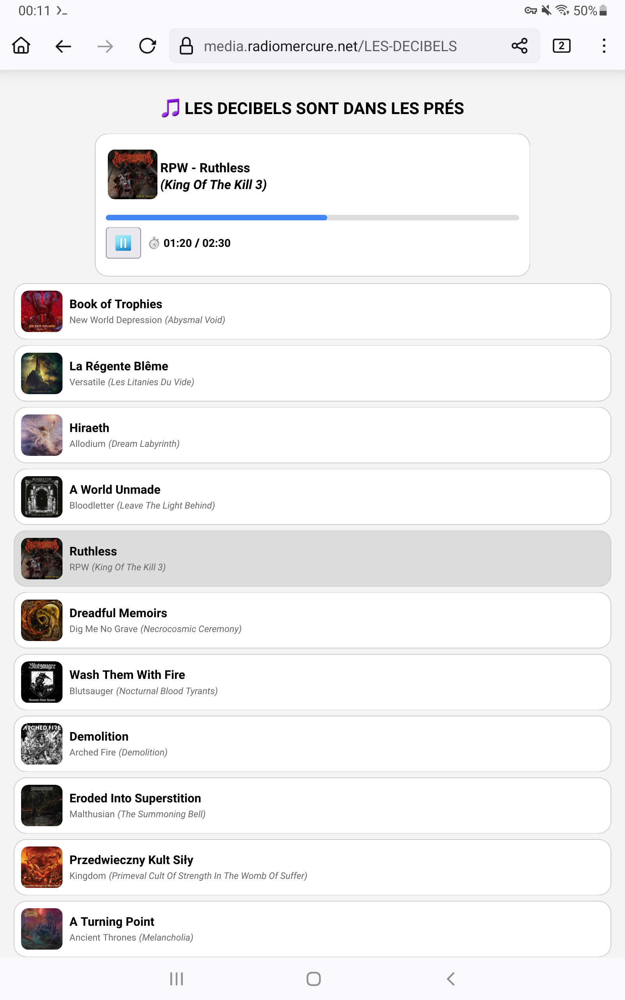

## Installation
- Clonez le dépôt 
- Renommez `conf/config.inc.php.sample` en `conf/config.inc.php`
- Renseignez-y les variables selon votre environnement
- Ajoutez les fichiers medias dans le dossier que vous avez crèè et defini dans la configuration

## Exemple d'utilisation
